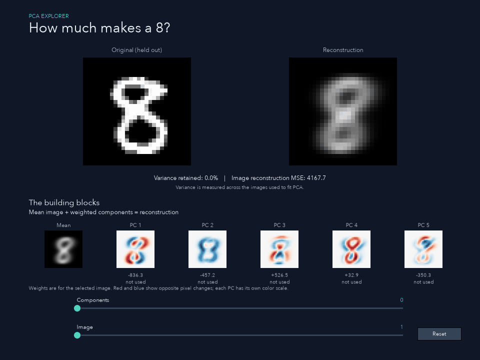

# Dimensionality reduction

Explore how principal component analysis (PCA) reconstructs handwritten digits,
or run PCA and Laplacian Eigenmaps on synthetic data. The PCA implementation
computes the mean, covariance, and projection using NumPy.

## Interactive image reconstruction



The preview follows the same held-out digit at 0, 10, and 100 components. At
zero components the reconstruction is the mean image. As you add components,
the reconstruction picks up more of the selected digit's shape.

From the repository root, run these commands with Python 3.14 on macOS or Linux.

```sh
python3.14 -m venv .venv
source .venv/bin/activate
python -m pip install -r requirements.txt
python pca_image_demo.py --digit 8 --holdout 0.2
```

The demo needs an interactive Matplotlib backend to open its window. Use the
Image slider to pick a sample and the Components slider to change the
reconstruction. Reset restores both sliders to their initial positions.
`python pca_image_demo.py` uses digit 3 and fits PCA on all images of that digit
in the bundled dataset. Use `--digit` to select a digit from 0 to 9 and
`--holdout` to reserve a fraction of its images for display. The split uses a
fixed random seed.

The gallery displays the mean image and the first five principal components.
Red and blue represent opposite pixel changes relative to the mean; each
component has its own color scale. A component's sign is arbitrary, and its
image is a pattern used in reconstruction, not a digit on its own. The gallery
shows the selected image's signed weight for each component and marks weights
not currently used in the reconstruction. The gallery is fixed, while the
reconstruction uses the number of components selected, including components
beyond those shown when more than five are chosen.

Variance retained describes the fraction of total variation in the fitted set
captured by the selected components. Mean squared error (MSE) compares the
selected original image with its reconstruction on the 0–255 pixel scale;
lower is better. The display clips pixel brightness to that range, but MSE uses
the unclipped reconstruction. This demo describes reconstruction quality, not a
measured file compression ratio.

## Run dimensionality reduction from the command line

```sh
python DR.py --auto_check
python DR.py --data Swiss_Roll --method PCA --out_dim 2 --display --save
python DR.py --data toy_data --method LE --out_dim 2 --display
python DR.py --data MNIST --method PCA --out_dim 2 --display
```

`--path` changes the input data directory (default `data`). For PCA,
`--display --save` writes the parameters to `results/` and any figure to
`results/plots/`, relative to the working directory. Those two flags are
required together for saving. Laplacian Eigenmaps supports display for the
Swiss roll and toy data.

The built-in `--auto_check` checks the PCA mean and principal direction on a
small dataset.

## Files

- `DR.py` loads the data, runs dimensionality reduction, and displays results.
- `pca_image_demo.py` interactively reconstructs handwritten digits with PCA.
- `data/` contains the Swiss roll and MNIST test datasets.
- `results/` contains saved PCA means and projection matrices, with
  visualizations in `results/plots/`.
- `feature_normalization.py` and `numpy_example.py` are standalone instructional
  examples. `collaboration.txt` records the collaboration statement.
